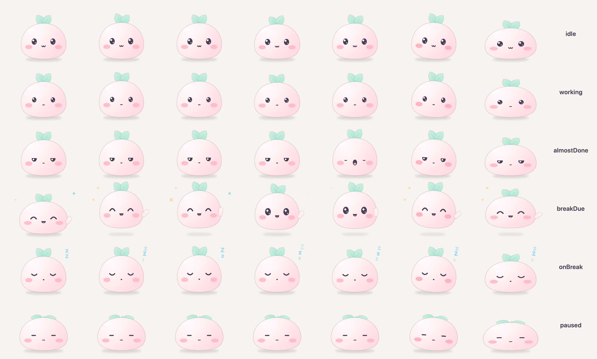

# Mochi 🍡🌱

A cute break-timer pet for macOS. A little mochi blob with a leaf sprout floats on your screen. It works alongside you, yawns when a break is near, and bounces with a tip when it's time to rest.



## Features
- **Floating mascot.** It's always on top, draggable, and never steals focus. It shows on every Space and over fullscreen apps. Choose Mini, Tiny, Small, Medium or Large.
- **Menu bar countdown** (`🌱 19:42`), with a popover for these controls:
  - Start, Pause / Resume, Take break now, Skip, Snooze, Reset and Stop
  - **−1 / +1 / +5 min** to adjust the time while the timer runs
- **Presets:**
  - Gentle 🌱 (default): 20 min focus, then a 20 s eye break. Every 3rd break is a 5 min stretch.
  - Pomodoro 🍅: 25/5, with a 15 min break every 4th.
  - Deep Focus 🌊: 52/17.
  - Custom ✨: choose your own lengths.
- **Gentle nudges:**
  - Mochi bounces and shows a tip bubble.
  - A notification with **Start break / Snooze 5 min / Skip**.
  - An optional soft chime.
  - Snooze is limited to 2 per break.
- **Mochi's moods:** working, almost done (yawning), break time (bouncing and waving), on break (sleeping Zzz), paused (droopy sprout) and chatting (happy eyes, talking smile).
- **Mochi talks to you.** It's a little friend that says sweet, kind things in its speech bubble, with a happy ^^ face and a smile that moves as it talks:
  - A hello once a day that fits the time ("Good morning, Anh! ☀️ How are you feeling today?"), with extra cheer on Mondays and Fridays.
  - Check-ins now and then ("How's your day going? 🌤️", "Have you had some water yet? 💧"), gentle affirmations, and cute fun facts ("Did you know? Otters hold hands while they sleep 🦦"). It has weekend and seasonal lines, and late at night it nudges you toward bed 🌙.
  - A hi every time it opens and when your mouse wanders over it, a welcome back after you step away, a thank-you after a break, and a sweet reply when you tap it.
  - Choose how often it talks (Off / Sometimes, about every 8 min, the default / Often, about every 2 min) and what it calls you in Settings. It stays quiet during breaks and just before one is due.
- **Flavors.** About every 2 hours (only while you're at the computer), Mochi does a little double spin and turns into a new flavor: 🍓 Strawberry, 🍵 Matcha, 🍠 Taro, 🫧 Ramune, 🍑 Peach or 🍌 Banana. The colors are inspired by classic kawaii pastels. Pick a flavor yourself or turn the changes off in Settings.
- **To-dos for the week.** Tap the 📝 badge by Mochi's feet (or **📝 To-dos** in the menu bar):
  - Type things like "go for a walkie 3pm" or "dentist friday 10am"; Mochi works out the day and time on its own.
  - Every day of the coming week is listed with its date. Pick a day with the **Today ▾** button or by tapping its heading; anything further out goes under **Later**.
  - Mochi helps on its own: a morning list, a reminder 10 minutes before timed to-dos, a check-in when a break starts, and an end-of-day wrap-up that offers to move unfinished things to tomorrow.
- **Smart Mochi ✨ (on-device AI).** On Macs with Apple Intelligence, Mochi uses Apple's built-in AI, which runs entirely on your Mac:
  - **Ask Mochi** in the to-do card: "Plan my day", "Plan my week", "Cheer me up", or anything like "remind me to stretch at 4". Mochi can add, move, tick off to-dos and start a focus or break, but only when you ask, only for to-dos you named, and it can't delete anything.
  - Personal kind words a few times a day, based only on counts (focus sessions, to-dos done), never your to-do names.
  - On other Macs (Intel, older macOS, or Apple Intelligence off) Mochi works the same, just without the AI parts.
- **Talk to Mochi 🎧.** Hold **Option + M** (or hold Mochi itself), talk, and let go; Mochi answers in its bubble and listens for your reply, so you can go back and forth. A quick tap of Option + M listens hands-free until you pause. Speech is recognized on your Mac only and never saved.
- **Your calendar 🗓️** (off until you turn it on in Settings ⚙︎ → Calendar). Mochi reads the Mac's Calendar app (Google Calendar works if it's added in System Settings → Internet Accounts), read-only:
  - A morning summary ("You have 3 meetings today. First up: Standup at 10:00 🌱") and a heads-up before each meeting (30 minutes by default) plus "Starting now".
  - Meetings show under each day in the week list, and Plan my day / Talk to Mochi know about them.
  - Mochi stays quiet while a meeting is happening; breaks wait until it ends.
- **Little extras** (Settings ⚙︎ → Mochi's little extras):
  - A greeting with the date whenever you come back to your Mac after 10+ minutes away ("Good morning! ☀️ It's Thursday, October 22.").
  - A good-night line once each evening (8 pm by default).
  - Lunch and dinner ideas around 12 and 6 (Any or Vegetarian, never the same idea twice in a week).
  - Self-care nudges (water, stretch, eyes) every hour or 30 minutes while the focus timer isn't running.
- **A first-launch hello** that shows you around and asks about notifications at a friendly moment.
- **Click Mochi** to start the timer, start a due break, or resume from pause. Any other time, it says something nice.
- **Stepping away counts.** Being idle, locked or asleep for 5 minutes or more counts as a break you took, and Mochi starts a fresh focus when you're back.
- Open at login, start automatically, show or hide Mochi, sound on or off.
- **Calm mode** (on by default): motion runs in Core Animation, so Mochi uses about 1% CPU while visible, against about 7% in full mode. Low Power Mode always uses calm mode, and Mochi doesn't chat while you're away from the keyboard.
- Honours Reduce Motion, light and dark mode.

## Privacy
- **Nothing leaves your Mac.** Mochi has no account, no server, no email access and no internet features.
- Smart Mochi uses Apple's **on-device** AI. It only sees your to-dos, today's timer counts, the time and the name you set, plus what you type to it, and it forgets each conversation when the card closes.
- Your to-dos live in one private file: `~/Library/Application Support/Mochi/todos.json` (readable only by your Mac account). Settings are in `~/Library/Preferences/com.anh.mochi.plist`.
- Reminder notifications can hide the to-do text (Settings ⚙︎ → To-dos).
- Calendar access is read-only and off by default. Events are kept in memory only, never saved or sent; the kind words only ever see a count of meetings.
- Talk to Mochi uses on-device speech recognition only; audio and transcripts are never saved.

## Uninstall
1. Quit Mochi from its menu bar item (**Quit Mochi**). If you turned on "Open Mochi at login", turn it off first.
2. Drag **Mochi** from your Applications folder to the Trash.
3. To remove your data too, delete `~/Library/Application Support/Mochi` and `~/Library/Preferences/com.anh.mochi.plist`.

## Build & run
You only need the Command Line Tools, not Xcode.

```bash
./build.sh
```

This builds the app, installs it to `~/Applications/Mochi.app` and launches it. Use `NO_OPEN=1 ./build.sh` to build without launching.

Run the checks:

```bash
swift run MochiChecks
```

Render the mascot poses to PNG:

```bash
swift run MochiPreview ./previews
```

### Debug switches
`MOCHI_CALM=0/1` forces full or calm animation. `MOCHI_POSE=breakDue` (or another pose) forces a pose.

### Fast demo mode
Use short timers to watch a whole cycle in seconds:

```bash
MOCHI_FOCUS_SECONDS=8 MOCHI_BREAK_SECONDS=6 MOCHI_IDLE_SECONDS=20 MOCHI_CHAT_SECONDS=30 MOCHI_FLAVOR_SECONDS=60 ~/Applications/Mochi.app/Contents/MacOS/Mochi
```

## Project layout
| Target | What's in it |
|---|---|
| `MochiCore` | Pure logic: `TimerEngine` state machine (based on end dates, so it survives sleep), `Preset`, `Tips`, `MochiSettings`, `AwayPolicy`, `Chatter`, to-dos (`TodoItem`, `TodoParser`, `TodoStore`, `TodoAgent`), Smart Mochi helpers (`AgentSnapshot`, `Positivity`) |
| `MochiUI` | Mascot drawn entirely with SwiftUI shapes (no image assets), poses, progress ring, speech bubble, `FloatingPanelController`, the to-do card (`TodoCardView`, `TodoCardController`) |
| `Mochi` | The app: `AppModel` (single owner), menu bar view, `MascotHost` (engine → pose), `Companion` (Mochi's chatter), `Nudger` (notifications and sound), `SystemMonitor`, `LaunchAtLogin`, `TodoCoordinator`, Smart Mochi (`MochiBrain`, `SmartMochi`, `PositivityCoordinator`) |
| `MochiChecks` | Logic checks (`swift run MochiChecks`) |
| `MochiPreview` | Renders poses and sizes to PNG for design review |

### Toolchain notes (this machine)
- **SwiftPM manifest fix.** Leftover Swift 5.10 `PackageDescription.private.swiftinterface` files in the Command Line Tools broke every package manifest. They were renamed to `.bak`.
- **Tests run through `MochiChecks`.** The installed `Testing.framework` is mismatched and silently discovers zero tests. Reinstalling the Command Line Tools should fix that, and then the checks could move back to Swift Testing.

## Releasing
`./package.sh` builds `dist/Mochi-<version>.zip`, a universal (Apple Silicon + Intel) app with an ad-hoc signature. Bump `CFBundleShortVersionString` in `Resources/Info.plist` first.

## Opening in VS Code
```bash
code .
```

Install the **Swift** extension (swiftlang). Build and run with `./build.sh`.

## Ideas for v2
- Detect fullscreen video and meetings (camera or mic in use), and hold nudges until they end.
- A global hotkey to start, pause or show the popover.
- Gentle stats: breaks taken today and a weekly streak, shown as a little garden that grows.
- More mascot skins (cat, sprout, cloud) and seasonal accessories.
- A sparkle burst when a break completes. The sprout reacts to clicks.
- A Shortcuts and Focus mode integration.
